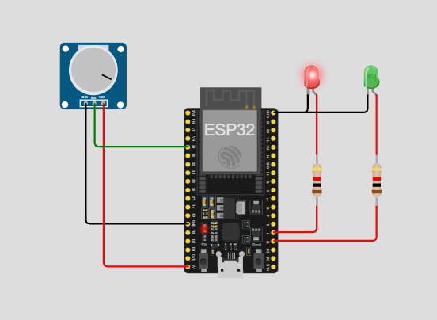
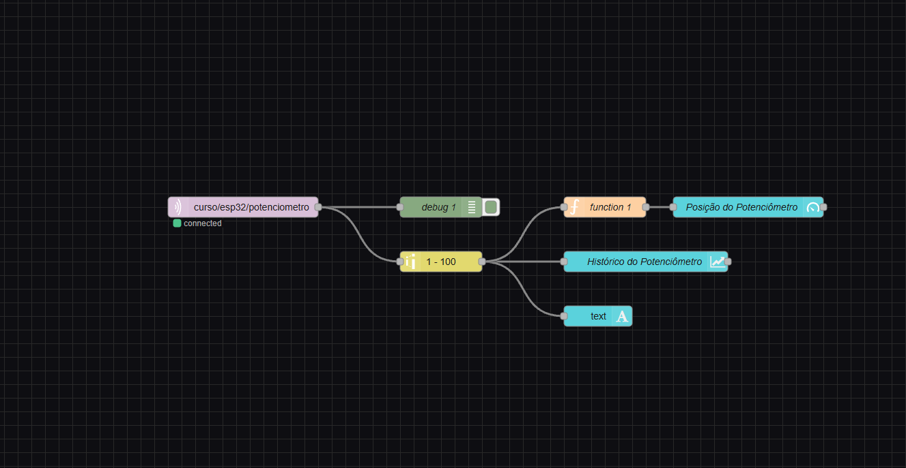
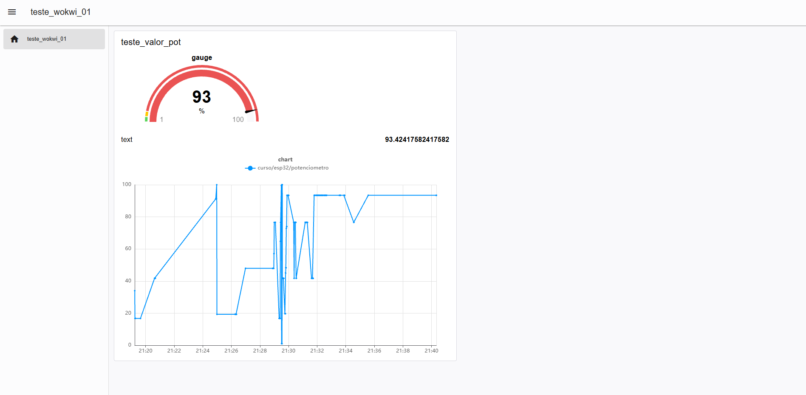

# ESP32 + MQTT + Node-RED | Monitoramento de Potenciômetro

Projeto desenvolvido com **ESP32**, utilizando o protocolo **MQTT** para transmitir dados de um potenciômetro em tempo real. Os dados são recebidos pelo **Node-RED**, onde são processados e apresentados em uma dashboard para visualização.

O objetivo é demonstrar a comunicação entre dispositivos IoT e aplicações de monitoramento por meio de um broker MQTT.

## 📸 Demonstração do projeto

### Circuito no Wokwi

Simulação do circuito com ESP32, potenciômetro e LEDs indicadores de conexão.

### Fluxo no Node-RED

Fluxo responsável por receber as mensagens MQTT, processar os dados e encaminhá-los para a dashboard.

### Dashboard

Interface de monitoramento que apresenta os valores enviados pelo potenciômetro em tempo real.

## ⚙️ Funcionamento

O projeto utiliza um ESP32 para realizar a leitura analógica de um potenciômetro e transmitir os valores obtidos por meio do protocolo MQTT.

O funcionamento acontece nas seguintes etapas:

1. **Leitura do sensor:** o ESP32 realiza a leitura analógica do potenciômetro conectado ao pino GPIO 34, obtendo valores entre 0 e 4095.
2. **Conexão Wi-Fi:** o dispositivo estabelece conexão com a rede Wi-Fi para permitir a comunicação com a internet.
3. **Comunicação MQTT:** o ESP32 conecta-se ao broker público HiveMQ (`broker.hivemq.com`) utilizando a porta `1883`.
4. **Publicação dos dados:** a cada segundo, o valor lido pelo potenciômetro é publicado no tópico `curso/esp32/potenciometro`.
5. **Processamento no Node-RED:** o Node-RED recebe as mensagens MQTT e utiliza os dados para alimentar os componentes da dashboard.
6. **Visualização:** os valores são apresentados na interface gráfica, permitindo acompanhar as alterações do potenciômetro.

## 🔌 Componentes e conexões

| Componente | GPIO / Conexão | Função |
|---|---|---|
| Potenciômetro | GPIO 34 | Leitura analógica |
| LED verde | GPIO 15 | Indicador de conexão MQTT |
| LED vermelho | GPIO 2 | Indicador de conexão Wi-Fi |
| Alimentação do potenciômetro | 5V | VCC |
| Referência do potenciômetro | GND | Terra |

## 🛠️ Tecnologias utilizadas

- **ESP32:** microcontrolador responsável pela leitura dos dados e comunicação.
- **C++ / Arduino Framework:** desenvolvimento do firmware.
- **Wokwi:** simulação virtual do circuito eletrônico.
- **Wi-Fi:** conexão do dispositivo à rede.
- **MQTT:** protocolo de comunicação utilizado para transmissão das mensagens.
- **HiveMQ:** broker MQTT público responsável por intermediar a comunicação.
- **Node-RED:** ferramenta de programação visual utilizada para receber, processar e apresentar os dados.
- **Dashboard:** interface gráfica para monitoramento das leituras.

## 📡 Configurações MQTT

| Configuração | Valor |
|---|---|
| Broker | broker.hivemq.com |
| Porta | 1883 |
| Protocolo | MQTT |
| Client ID | ESP32_WOKWI_01 |
| Tópico | curso/esp32/potenciometro |
| Intervalo de publicação | 1 segundo |
| Formato da mensagem | Numérico (String) |

## 💡 Indicadores de conexão

O circuito utiliza dois LEDs para indicar o estado das conexões:

- **LED verde (GPIO 15):** permanece aceso enquanto o ESP32 está conectado ao broker MQTT.
- **LED vermelho (GPIO 2):** permanece aceso enquanto o ESP32 está conectado à rede Wi-Fi.

Caso alguma conexão seja interrompida, o dispositivo tenta restabelecê-la automaticamente.

## 🎯 Objetivos de aprendizagem

- Compreender o funcionamento do protocolo MQTT.
- Estabelecer comunicação entre um ESP32 e um broker MQTT.
- Realizar publicação e recebimento de mensagens.
- Integrar dispositivos IoT com o Node-RED.
- Desenvolver uma dashboard para visualização de dados em tempo real.
- Trabalhar com leitura analógica e indicadores de estado em sistemas embarcados.

---

**Projeto desenvolvido para fins educacionais, explorando conceitos de IoT, comunicação MQTT e monitoramento de dados.**
